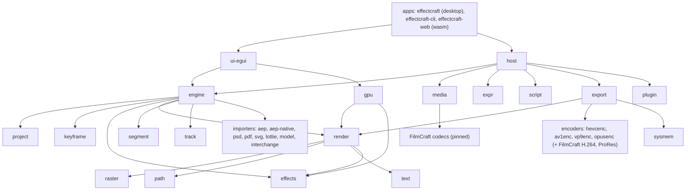

# Code map (our fork)

What each part of the tree owns, how the parts connect, and what is platform-specific. Upstream's detail is in its own `docs/architecture.md` and `AGENTS.md`; this map is ours, for sizing and placing issues. Our goal maps (the `.aep` reader, fidelity, exports) are in `docs/maps/`. Read from the tree on 2026-10-28: a Cargo workspace of `crates/*`, `apps/*` and `xtask` (37 crates, 3 apps; version 0.17.0, branch `main`). Media decoding and timeline interchange come from FilmCraft crates (pinned by revision in the root `Cargo.toml`; only `media`, `export` and `interchange` may depend on them).

Describes commit: 8ec2281d (2026-10-28)

Upstream owns everything not named under "Ours only" and "Where our delta lives". At this commit our `main` is 137 commits ahead of upstream `main` (many are sync merges) and 87 behind; against upstream it is 158 files, about +40,700 / -220, of which roughly 19,000 lines are one data file (`integrations/effectcraft/ae_effect_map.json`).

## Layers

## Parts

| Part | Crates | Owns | Platform notes |
|---|---|---|---|
| Apps | `apps/effectcraft`, `apps/effectcraft-cli`, `apps/effectcraft-web` | Desktop entry (`--comp` opens one composition, ours; Wayland window fit in `wayland_screen.rs`, ours); headless CLI (`render-frame`, `render`, `bench`, `info`, `diagnostics`, MCP); browser build; self-logging hooks in both native apps (`self_logging*.rs`, ours) | GPU needed to start the desktop window |
| UI | `ui-egui` | Docking panels, composition viewer, timeline, effect controls, control channel. Wayland window fit is not here: it is in `apps/effectcraft` (`wayland_screen.rs`, ours) | Wayland file drops broken (#27) |
| Engine and host | `engine`, `host`, `automation`, `script`, `expr` | Session, undo, command registry; the importers are wired in `engine` (`commands/aep.rs`, `aep_native.rs`, `psd_import.rs`; our footage-follow in `media_anchor.rs`); `host` wires the session to decoding, expressions, scripting, export and plug-ins; MCP; AE-style scripting and expressions (boa JavaScript) | all |
| Document | `project`, `keyframe`, `time`, `geom`, `color` | Project items, compositions, layers, property tree; keyframes and easing | all |
| Import | `aep-native` (ours), `aep` (carried from upstream PR 860, not in upstream `main`), `psd`, `pdf`, `svg`, `lottie`, `model`, `interchange`, `media` | Our `.aep` reader; the converter-based AE import (`aep` reads JSON written by the Python scripts in `packaging/aep/`, which need `py-aep` installed; `integrations/effectcraft/` holds its effect map and font calibration helper); PSD, PDF/AI/EPS, SVG, Lottie, 3D models; Premiere interchange via FilmCraft; footage import and frame cache | footage paths across Windows / macOS / Linux (folder-follow is ours: `engine/src/media_anchor.rs`, `project/src/anchor.rs`); the converter path needs Python |
| Render | `render`, `raster`, `path`, `text`, `effects`, `gpu`, `track`, `segment`, `plugin` | CPU compositor (the reference); images and warps; Bezier paths; text engine; effects library; wgpu compute compositor; tracking and roto; trained models; WebAssembly effect plug-ins | GPU backends differ (Metal, DX12/Vulkan, RADV); two GPU pixel tests fail on AMD RADV (upstream's); `gpu` depends on `render` and `effects`, not the other way round |
| Export | `export`, `hevcenc`, `av1enc`, `vp9enc`, `opusenc`, `sysmem` (ours) | Render Queue and output modules; pure-Rust encoders (software only: no hardware encoder here, so NVENC and VA-API are not in this repo); free-memory reading that sizes frames in flight (`export/src/in_flight.rs`, ours) | `sysmem` reads memory per OS (Linux, Windows, macOS) |
| Ours only | `craft-log`, `craft-stage`, `sysmem`, `aep-native` | Self-logging (`craft-log`, also wired in `gpu/src/self_logging.rs`), named stages, memory reading, our `.aep` reader | — |
| Tooling | `xtask` | Build tasks and the layer check (left out of the default members) | — |
| Not crates | `integrations/`, `extensions/scriptui-panels/`, `examples/`, `packaging/` | AE effect map and font helper; After Effects ScriptUI panels (Ease Presets); example plug-ins and ease oracle scripts; Linux, macOS, Windows, FreeBSD, web and AEP-converter packaging | `packaging/aep` needs Python |

## CI

Workflows are upstream's (`.github/workflows/`): `ci.yml` (the test gate, on push to `main`, pull requests and manual runs), `sonarcloud.yml` (push to `main`, pull requests), `nix.yml` and `packaging-lint.yml` (push to `main` and pull requests, for their own paths), `windows-arm64.yml` and `freebsd.yml` (nightly and on pushes to `release`; pull requests only for their own paths), and `release.yml` (pushes to `release`). The test gate is enabled on our fork but has not run on it yet (#44); the other workflows run on GitHub's runners.

## Where our delta lives

D1 `crates/aep-native`, with `crates/engine/src/commands/aep_native.rs`; `crates/aep` and `packaging/aep` are the carried upstream PR 860 path · D2 `crates/render` (`masks.rs`), `crates/effects` (`color_fx.rs`, `puppet`), `crates/gpu`, `crates/keyframe` (`text_doc.rs`), `crates/text` (`fonts.rs`), `crates/psd` (`read.rs`) · D3 `crates/export/src/in_flight.rs`, `crates/sysmem`, `crates/media` (`pool.rs`) · D4 `apps/effectcraft` (`--comp`), `crates/engine` · D5 `crates/craft-log`, `crates/craft-stage`, `crates/sysmem`, `self_logging*.rs` in both native apps and in `crates/gpu` · D6 `apps/effectcraft/src/wayland_screen.rs`, `crates/engine/src/media_anchor.rs`, `crates/project/src/anchor.rs` · D7 `crates/gpu` (`walk.rs`) · D8 not built · D9 root `Cargo.toml` (the FilmCraft pin), `crates/media`, `crates/export`.
