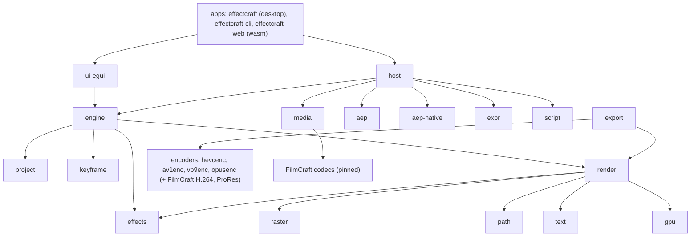

# Code map (our fork)

What each part of the tree owns, how the parts connect, and what is platform-specific. Upstream's detail is in its own `docs/architecture.md` and `AGENTS.md`; this map is ours, for sizing and placing issues. Our goal maps (the `.aep` reader, fidelity, exports) are in `docs/maps/`. Read from the tree on 2026-10-26: a Cargo workspace of `crates/*`, `apps/*` and `xtask`. Media decoding and timeline interchange come from FilmCraft crates (pinned).

## Layers

## Parts

| Part | Crates | Owns | Platform notes |
|---|---|---|---|
| Apps | `apps/effectcraft`, `apps/effectcraft-cli`, `apps/effectcraft-web` | Desktop entry; headless CLI (`render-frame`, `render`, `info`, `diagnostics`, MCP); browser build | GPU needed to start the desktop window |
| UI | `ui-egui` | Docking panels, composition viewer, timeline, effect controls, control channel | Wayland window fit (ours); Wayland file drops broken (#27) |
| Engine and host | `engine`, `host`, `automation`, `script`, `expr` | Session, undo, command registry; wired session (decoding, importers, expressions, scripting); MCP; AE-style scripting and expressions (boa JavaScript) | all |
| Document | `project`, `keyframe`, `time`, `geom`, `color` | Project items, compositions, layers, property tree; keyframes and easing | all |
| Import | `aep-native` (ours), `aep`, `psd`, `pdf`, `svg`, `lottie`, `model`, `interchange`, `media` | Our `.aep` reader; upstream's converter-based AE import; PSD, PDF/AI/EPS, SVG, Lottie, 3D models; Premiere interchange via FilmCraft; footage import and frame cache | footage paths across Windows / macOS / Linux (folder-follow is ours) |
| Render | `render`, `raster`, `path`, `text`, `effects`, `gpu`, `track`, `segment`, `plugin` | CPU compositor (the reference); images and warps; Bezier paths; text engine; effects library; wgpu compute compositor; tracking and roto; trained models; WebAssembly effect plug-ins | GPU backends differ (Metal, DX12/Vulkan, RADV); two GPU pixel tests fail on AMD RADV (upstream's) |
| Export | `export`, `hevcenc`, `av1enc`, `vp9enc`, `opusenc`, `sysmem` (ours) | Render Queue and output modules; pure-Rust encoders; free-memory reading that sizes frames in flight | `sysmem` reads memory per OS (Linux, Windows, macOS) |
| Ours only | `craft-log`, `craft-stage`, `sysmem`, `aep-native` | Self-logging, named stages, memory reading, our `.aep` reader | — |
| Tooling | `xtask` | Build tasks and the layer check | — |

## CI

Workflows are upstream's (`.github/workflows/`): `ci.yml` (the test gate), `windows-arm64.yml`, `nix.yml`, `freebsd.yml`, `packaging-lint.yml`, `sonarcloud.yml`, `release.yml`. On our fork the test gate has never run (see its issue).

## Where our delta lives

D1 `crates/aep-native` · D2 `crates/render`, `crates/effects`, `crates/gpu` · D3 `crates/export`, `crates/sysmem` · D4 `apps/effectcraft` (`--comp`), `crates/engine` · D5 `crates/craft-log`, `crates/craft-stage` · D6 `crates/ui-egui`, `crates/media` · D7 `crates/gpu`.
